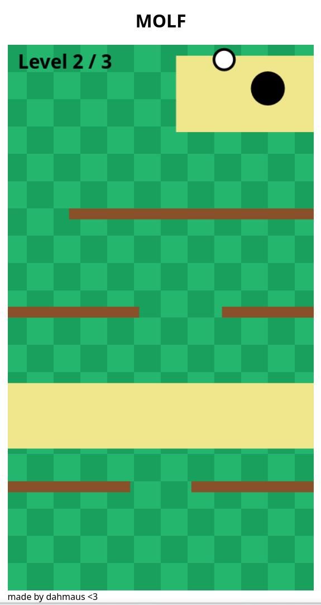

# MOLF

A simple 2D mini golf game with 3 levels :D
## Showcase

## Try it out

[**Play MOLF**](https://dahmaus.github.io/Molf/)

## Features

- **3 Levels**: 3 tiny levels (i will add more in the future (likely lol))
- **Sand**: Slow down the ball when it lands in sand
- **Moving Platforms**: they move move move around
- **Fans**: spread the ball around!

## Run locally

1. Clone this repo :^
2. Open `index.html` in your browser <:
3. Play MOLF! :D

## AI disclosure

Minimal use, used if i didn't have a other option (had either no knowledge or didn't find anything i wanted while searching)

## Credits

Made by me, dahmaus :D

Written in HTML, CSS and JavaScript with love <3
